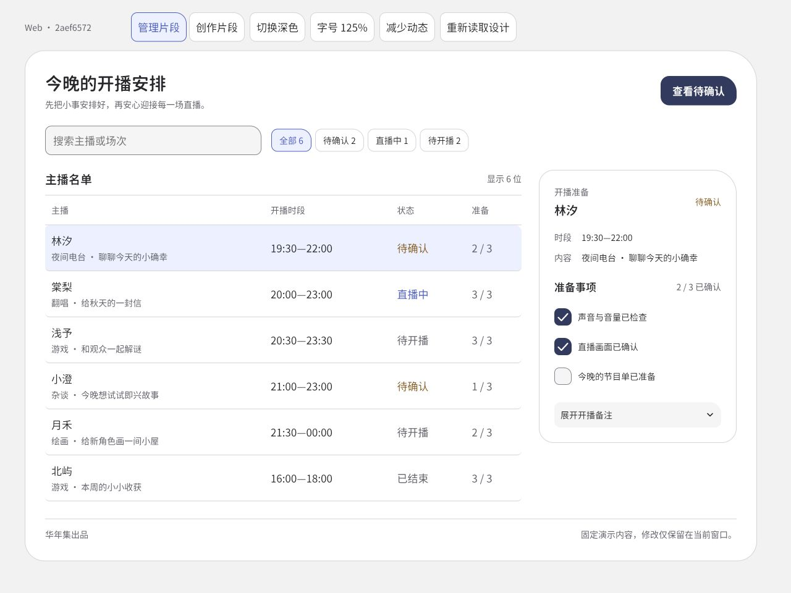
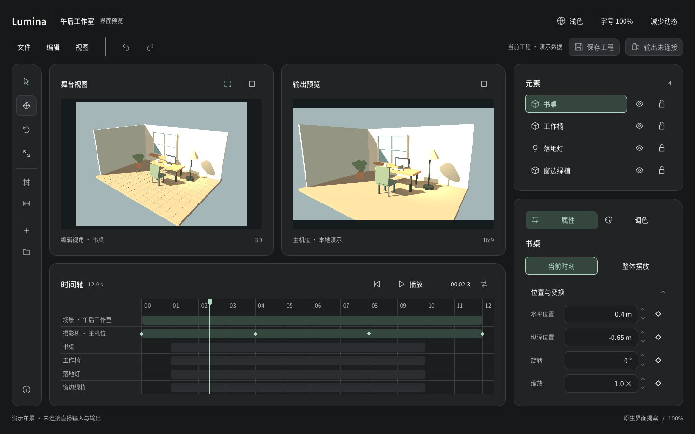

# 可见参照与适用范围

新设计、改版和参考复现时实际打开与任务有关的图片。它们说明已经认可的家族表达，不是一套必须照搬的页面。用户自己的已选基准和项目当前决定优先；当前参数与实现从资源表定位，不能从历史截图反推冻结数值。

## 管理界面的阅读与留白

来源：2026-10-27 P2 整体验收的 Web 管理样张，构建 `2aef65724968bcedff08`，截图为文字放大状态。可参考信息主次、列表与详情关系、分层留白、圆润承载和整项选中。样张强调色不属于家族必选色，文字放大状态不作为默认字号。数据是示例；表格／详情布局不能直接套到登录或验证码页面。

## 专业创作工作区

来源：2026-10-28 已认可独立 Lumina 案例的 Godot 视口截图，1440×900、深色、100%，与 `0.1.0` 随包案例同源。可参考双预览、单时间轴、元素／属性区的主次与专业密度，以及工具分组、图标、参数和关键帧的留白关系。图片中某一工具处于悬停／选中状态，须结合实际状态理解。该图不是正式 Lumina 当前版本；后续产品变化由其项目档案负责。

本例的布局、紧凑尺度和图标底框偏好属于专业工作区，不自动成为所有产品默认。画布和标尺保持精确边界，不能因此取消整个界面的家族形状；反之也不把精确图像区域硬裁成装饰圆角。

## 看图后的使用方式

在项目里说明采用哪些关系、哪些需要改变及原因，再用真实内容实现。需要观察运动时运行 `foundation/web/showcase.html` 对应入口或通过 `scripts/portable.py prepare` 组装原生案例；静态图不证明动画、焦点或点击正确。

本包没有已验收的账号系统整页模板。登录、验证、安全设置或账号管理应按实际任务设计；不能把管理样张当成这些页面的既定标准。要精确复现某个账号页面时，取得并实际查看其指定基准。
